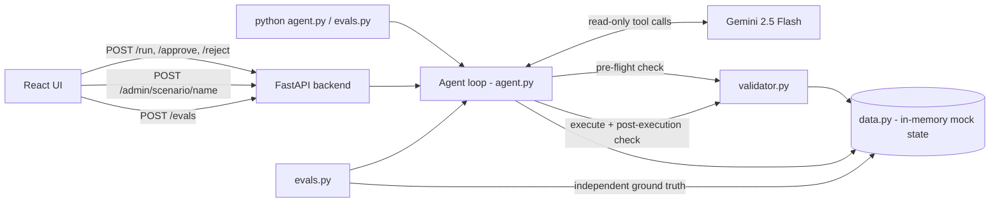

# AI Purchasing Agent

An agent that reviews a purchase recommendation, investigates it with tools, decides whether to
accept/modify/reject it or investigate further, and — for anything it decides to buy — validates
the result before and after acting. It is not a chatbot: it makes, executes and validates a
purchasing decision.

Implements **Scenario 1** (review a purchase recommendation) end to end.

## Architecture



- **Mock data / mock API** (`data.py`): inventory, demand forecast, open POs, supplier terms,
  budget and storage for a single product (`SKU-1001`) at one node, held as plain in-memory
  Python dicts. `data.reset()` restores defaults; `data.SCENARIOS` holds named presets
  (`oversupplied`, `understocked`, `below_moq`, `budget_cap`, `storage_cap`, `stale_forecast`)
  used for manual demos and for the eval suite.
- **Tools** (`tools.py`): read-only functions the LLM can call (`get_inventory`,
  `get_demand_forecast`, `get_open_purchase_orders`, `get_supplier_terms`, `get_budget`,
  `get_storage_capacity`), plus `calc_net_need` — the one deterministic calculation
  (demand over lead time, minus on-hand, minus incoming open POs, rounded to the case pack). The
  LLM is told to call this instead of doing the arithmetic itself.
- **Agent** (`agent.py`): the system prompt, the manual tool-calling loop (automatic function
  calling is deliberately disabled — see **Design notes** below), the approval gate, and the
  execute/verify step.
- **Validator** (`validator.py`): plain deterministic code, separate from the LLM. `validate_po`
  is the pre-flight check; `execute_po` creates the PO and mutates budget/storage; `verify_result`
  is the post-execution check.
- **API** (`api.py`): a thin FastAPI wrapper — `/state`, `/scenarios`, `/admin/scenario/{name}`,
  `/run`, `/approve`, `/reject`, `/evals`.
- **UI** (`frontend/`): one React page — current state, a scenario-preset switcher, a form to run
  a recommendation, the decision + tool-call trace + approval controls, and an "Evaluation"
  section that runs and displays the eval suite.
- **Evals** (`evals.py` + `eval_cases.py`): a small, independent scoring harness — see
  **Evaluation** below.

## Setup and run

Requires Python 3.10+ and Node 18+.

```bash
python3 -m venv .venv
source .venv/bin/activate
pip install -r requirements.txt
cp .env.example .env        # then put your Gemini API key in .env
```

Start the backend (from the project root):

```bash
uvicorn api:app --reload --port 8000
```

Start the UI (second terminal):

```bash
cd frontend
npm install
npm run dev                 # open http://localhost:5173
```

Restarting `uvicorn` re-imports `data.py`, which resets all mock state back to defaults — so
after a restart, re-apply whichever scenario preset you want from the UI's **Preset** dropdown
before running again.

## Approach

The LLM does the judgement; plain code does the maths, the rules and the actions.

- The agent treats the system's recommended quantity as a hypothesis, not an instruction — the
  prompt explicitly says never to trust it blindly.
- It investigates using read-only tools before deciding. The real quantity needed always comes
  from `calc_net_need`, never from the LLM's own arithmetic:

  `net_need = daily_demand * lead_time_days − on_hand − incoming_open_PO_qty`,
  rounded up to the product's case pack, for whichever supplier's lead time is being evaluated.
- The LLM returns one decision — `accept`, `modify`, `reject` or `investigate` — with a supplier,
  a quantity, and the reasoning behind it, as a strict JSON object.
- The LLM **cannot write**. Creating a PO is done by plain code (`validator.execute_po`), only
  after pre-flight validation passes, so the LLM can't skip a check by phrasing its answer
  differently.

### The loop (`agent.run_scenario`)

```
investigate and decide (LLM + tools, manual tool-calling loop)
  -> pre-flight validate_po        (MOQ, case pack, budget, storage — violations stop the run)
  -> approval gate                 (order value over APPROVAL_VALUE_THRESHOLD -> awaiting_approval)
  -> execute_po                    (creates the PO, deducts budget/storage)
  -> verify_result                 (re-checks the outcome against the real need)
```

### Human in the loop

Orders whose value (`quantity x unit price`) exceeds `APPROVAL_VALUE_THRESHOLD` (default **$500**,
set in `.env`) stop at `status: "awaiting_approval"` instead of executing automatically. The UI
shows an **Approve** / **Reject** control at that point:

- **Approve** re-runs pre-flight validation (budget/storage may have changed while the run was
  waiting) and only then executes and verifies.
- **Reject** discards the decision — no PO is created.

This is the one explicit pause-for-a-human point in the system. The other situations that
functionally land on a human (an `investigate` decision, or a pre-flight failure with no feasible
fix) don't have a separate "resolve this" action yet — they're surfaced in the result for a person
reading the UI to act on, which is a known limitation (see below).

## Validation (how decisions are checked)

Two independent checks, both plain code, neither of them the LLM:

1. **Pre-flight (`validator.validate_po`)** — before anything is created: supplier exists and is
   known, quantity is positive, meets the supplier's MOQ, is a multiple of the case pack, fits the
   remaining budget, and fits the remaining storage.
2. **Post-execution (`validator.verify_result`)** — after the PO is created: status is
   `"confirmed"`, the quantity actually ordered is not less than the real need
   (`calc_net_need` recomputed for the chosen supplier's lead time), and budget/storage didn't go
   negative. If this fails, the result's `status` becomes `"verification_failed"` instead of
   `"success"` — the system knows the outcome didn't match what it expected, rather than silently
   reporting success.

Every tool call the LLM makes is also recorded (`tool_calls` in the result, shown in the UI behind
a "Show tool calls" button), so a decision's reasoning can be checked against what it actually
looked at.

## Mock APIs / data / supporting services

Everything here is mocked, in-process, in `data.py` — no external services or real database:

- Product `SKU-1001`, case pack 10.
- Suppliers: `SUP-A` (lead time 5 days, MOQ 100, $10/unit), `SUP-B` (lead time 7 days, MOQ 50,
  $11/unit).
- Default state (`oversupplied`): on-hand 50, a 600-unit open PO arriving in 5 days, $10,000
  budget, 500 units of storage — true need is 0 regardless of what's recommended, which is the
  "don't trust the recommendation blindly" case from the assignment brief.
- Named presets in `data.SCENARIOS` for exploring other outcomes:

  | Preset | What changes | Try with qty | Expect |
  |---|---|---|---|
  | `oversupplied` (default) | — | 800 | `reject` (no real need) |
  | `understocked` | no on-hand, no open PO | 100 | `accept` (SUP-A, qty 100) |
  | `below_moq` | on-hand 30, no open PO | 70 | `modify` (real need is below SUP-A's MOQ) |
  | `budget_cap` | on-hand 10, no open PO, budget $300 | 90 | nothing fits the budget |
  | `storage_cap` | on-hand 10, no open PO, storage 20 units | 90 | nothing fits storage |
  | `stale_forecast` | no on-hand, no open PO, forecast 15 days old | 100 | `investigate` |

Switch presets from the UI's **Preset** dropdown + "Apply scenario" button, or call
`data.apply_scenario("understocked")` directly in Python / via `POST /admin/scenario/understocked`.

## Evaluation

`eval_cases.py` defines 4 cases (`double_count`, `moq_adjustment`, `budget_cap`, `storage_cap`),
each a `data.py` override plus a recommended quantity. `evals.py` runs each case against the real
agent (real LLM calls, not mocked) and scores it:

1. **Ground truth is computed independently** (`expected_outcome` in `evals.py`), with its own
   plain arithmetic — it does not call `calc_net_need` or `validate_po`, so a bug in the agent's
   own logic can't also hide itself from the eval.
2. For each case: does a PO exist exactly when it should (`action_matches_expectation`)? If one
   was created, does it respect MOQ / case pack / budget / storage, and did post-execution
   verification come back clean? If none was created, was it blocked for a legitimate reason
   (the decision wasn't accept/modify, or pre-flight genuinely failed) rather than silently
   skipped?
3. If a run pauses for approval, the eval approves it itself (`agent.approve_run()`) so it can see
   the end-to-end outcome.

Run it with:

```bash
python evals.py
```

or from the UI's "Evaluation" section ("Run evals" button), which calls `POST /evals` and renders
the same rows as a table.

Because the LLM is not fully deterministic, a case can occasionally flip to a different
(still valid) supplier/quantity choice — the checks are written against whatever the agent
actually chose, not a hardcoded answer, so a different-but-still-correct choice still passes.
A known gap: the checks confirm the chosen quantity is *feasible*, not that it's the exact
cheapest option — a valid-but-suboptimal choice (e.g. the pricier supplier when the cheaper one
would also work) currently still passes.
